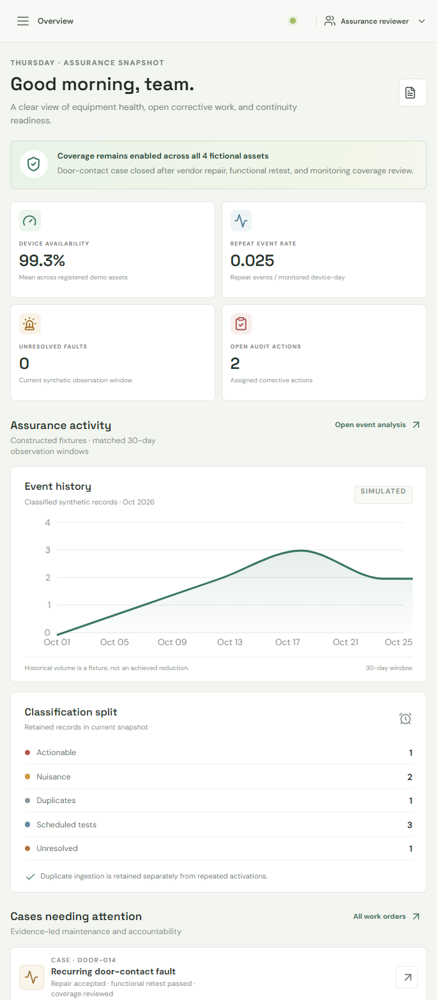

# SiteShield Continuity

SiteShield Continuity is a synthetic maintenance-coordination and preparedness workspace. It demonstrates how fictional physical-security assets, inspection findings, alarm-event classifications, vendor work, shift handoffs, and continuity exercises can be recorded together. It is not an operational alarm controller.

## Demonstration status

All sites, people, IDs, event histories, repair notes, and exercise outputs are fictional. The recurring door-contact case is a worked synthetic example: repeated event records lead to an approved vendor scope, a documented repair, a successful functional retest, a monitoring-coverage review, and reviewer acceptance. The matched seven-day before/after event counts are constructed fixtures, not an achieved alarm reduction. Event-volume changes alone do not establish improved security.

No feature suppresses alarms, changes thresholds, bypasses controls, disables devices, exposes device endpoints or credentials, or accepts arbitrary evidence uploads. The storm/outage and incident-mitigation scenarios are discussion-based tabletops, not emergency response. Use employer procedures and authorized professional direction for real events.

## Workspace screenshot



## Run locally

Prerequisites: Python 3.12+, Node.js 22+, npm, and PostgreSQL for persistent multi-service use. SQLite is the local default.

```powershell
cd backend
python -m venv .venv
.\.venv\Scripts\Activate.ps1
pip install -r requirements.txt
$env:DATABASE_URL = "sqlite:///./siteshield.db"
$env:AUTH_SECRET_KEY = (python -c "import secrets; print(secrets.token_urlsafe(48))")
alembic upgrade head
python -m scripts.seed_demo
python -m scripts.create_account --username reviewer-one --role reviewer
uvicorn app.main:app --reload
```

In another terminal:

```powershell
cd frontend
npm ci
$env:VITE_API_URL = "http://localhost:8000"
npm run dev
```

Open the Vite URL printed in the terminal (normally `http://localhost:5173`). API health is `http://127.0.0.1:8000/health`; interactive API documentation is at `/docs`.

Workspace sections have refreshable paths: `/`, `/asset-register`, `/audits`, `/alarms`, `/work-orders`, `/handoffs`, `/continuity`, and `/awareness`.

## Reproducible checks

```powershell
cd backend
python -m pytest tests -q
```

```powershell
cd frontend
npm ci
npm run check
npm run build
```

CI runs the backend tests and frontend check/build on pull requests and pushes. GitHub Actions retains each run with its triggering commit SHA and result.

## Demo roles and limitations

Sign in with Microsoft Entra ID when the OIDC settings below are configured. The backend validates the signed ID token, tenant, audience, required MFA `amr` claim, and assigned SiteShield app roles; the active role can only be selected from roles in that signed claim and is never accepted directly from a client header. Signed HttpOnly cookies and CSRF protection guard the application session. With Entra unconfigured, local Argon2 password accounts are available only for development.

Vendor records are hidden unless explicitly marked vendor-visible; case data in the seed profile is not shared. `/health` returns only `{"status":"ok"}`. CORS should be restricted to the exact frontend origin, but CORS is not authentication.

## Railway deployment

Deploy three separate Railway services: PostgreSQL, backend with root directory `/backend`, and frontend with root directory `/frontend`. Set backend `DATABASE_URL` from the PostgreSQL service reference; this project converts `postgres://` and `postgresql://` schemes to `postgresql+psycopg://`. Set backend `CORS_ORIGINS` to the exact HTTPS frontend origin, `AUTH_SECRET_KEY` to a generated secret of at least 32 characters, `AUTH_COOKIE_SECURE=true`, and `AUTH_COOKIE_SAMESITE=none` for credentialed requests between the separate Railway subdomains. Set frontend `VITE_API_URL` to the backend's full HTTPS origin before building and assign the frontend public-domain target port `8080`. The backend binds to Railway's assigned `PORT`.

For Microsoft Entra, register a single-tenant web app and set the redirect URI to `https://siteshield-backend-production.up.railway.app/api/auth/entra/callback`. Configure backend variables `ENTRA_TENANT_ID`, `ENTRA_CLIENT_ID`, `ENTRA_CLIENT_SECRET` (secret), `ENTRA_REDIRECT_URI`, and `AUTH_FRONTEND_URL=https://siteshield-frontend-production.up.railway.app/`. Define app roles with values `analyst`, `reviewer`, `vendor`, and `leadership`, and assign only the roles each user needs; the application selector is limited to the roles in that user's signed Entra token. Add the `amr` ID-token optional claim with granular AMR values and require MFA using an Entra Conditional Access policy. The backend keeps local password login enabled until all Entra settings and a 32+ character `AUTH_SECRET_KEY` are present; then the UI switches to Entra and local password login is disabled.

Federated account keys are stored as hashes of tenant/object IDs, and the UI uses a generic workspace label instead of Entra names or email addresses. The migration also pseudonymizes existing federated account keys, display names, and account audit references.

Run migrations as a controlled release step with `python -m scripts.release` from `/backend`; it applies `alembic upgrade head` and then runs the one-time account provisioner, which is disabled unless `ALLOW_ACCOUNT_PROVISIONING=true`. Seed only an explicit synthetic profile with `python -m scripts.seed_demo`; do not automatically seed production or store credentials in source control. For this deployment, migration, health, role visibility, the vendor-to-reviewer maintenance workflow, restart persistence, and `/asset-register` deep-link refresh were verified. Rebuild the frontend if its API URL changes.

The seed contains no Entra accounts. Assign users to the app roles in Entra Enterprise Applications. The Entra roles replace per-account provisioning in this mode. Keep the one-time local account provisioner disabled when Entra is enabled.

This public instance contains only fictional records and has its own isolated PostgreSQL service. To restore the demo after testing, set `ALLOW_DEMO_RESET=true` on the backend and run `railway run --service siteshield-backend -- python -m scripts.reset_demo` from `/backend`. The command also requires `DEMO_MODE=true`; it is not exposed as an HTTP endpoint. Keep reset disabled on any non-demo environment.

Live frontend: https://siteshield-frontend-production.up.railway.app

Live backend health: https://siteshield-backend-production.up.railway.app/health

The services run in Railway's `us-west2` region. PostgreSQL was migrated through the backend pre-deploy release command, then populated only through the explicit synthetic seed profile. An anonymized, authenticated reviewer overview from the live workspace is included at `docs/siteshield-dashboard.png`; the seeded case and fixture files are the reproducible worked reports for this source delivery.

## Project map

- `backend/`: FastAPI, SQLAlchemy, Alembic, role demonstration, metrics, and tests.
- `frontend/`: React/Vite workspace and Recharts synthetic event history.
- `fixtures/`: CSV inventory/events and the discussion-based storm tabletop scenario.
- `docs/`: audit, vendor, continuity, exercise, and awareness reference materials.

Data retention is not configured. Audit entries demonstrate approval and state-change recording; export auditing is not implemented because no export feature is provided. Entra federation and MFA enforcement depend on tenant app registration and Conditional Access configuration; those tenant-side settings must be completed and tested by an Entra administrator before treating production sign-in as organization-managed.